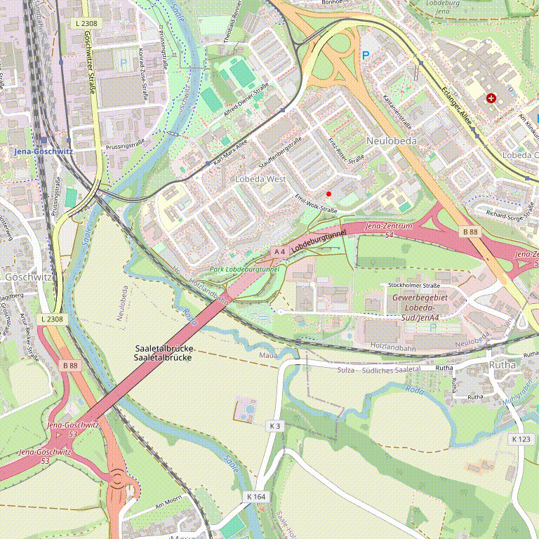
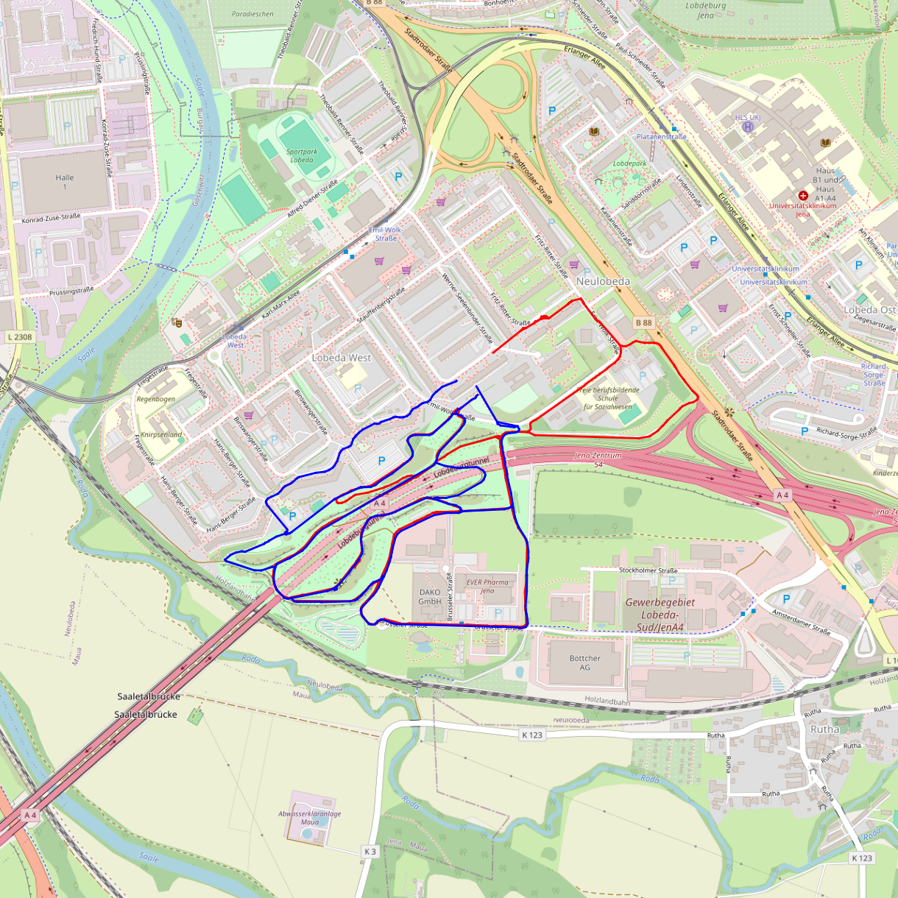
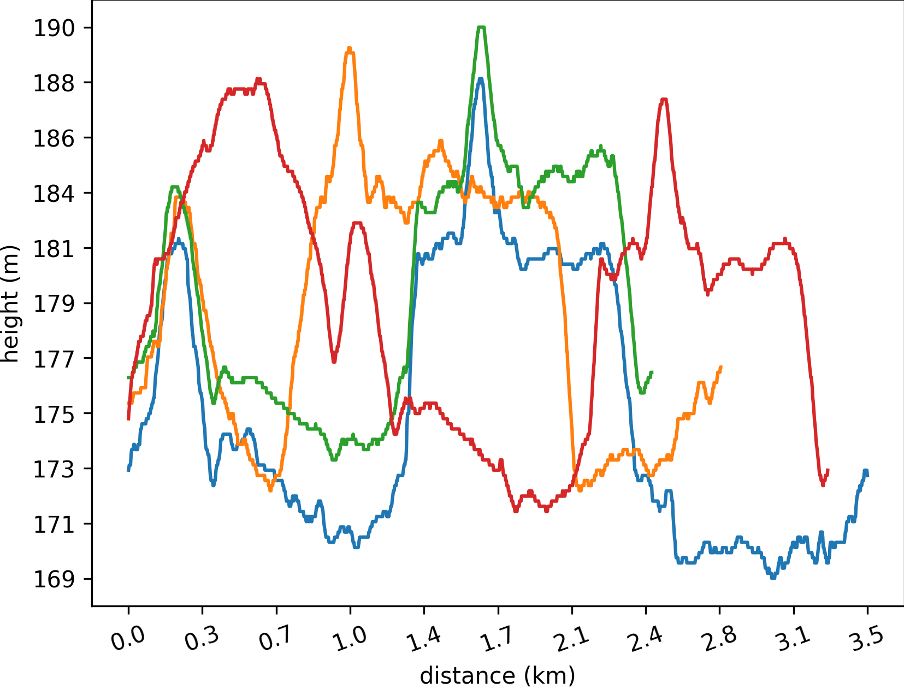
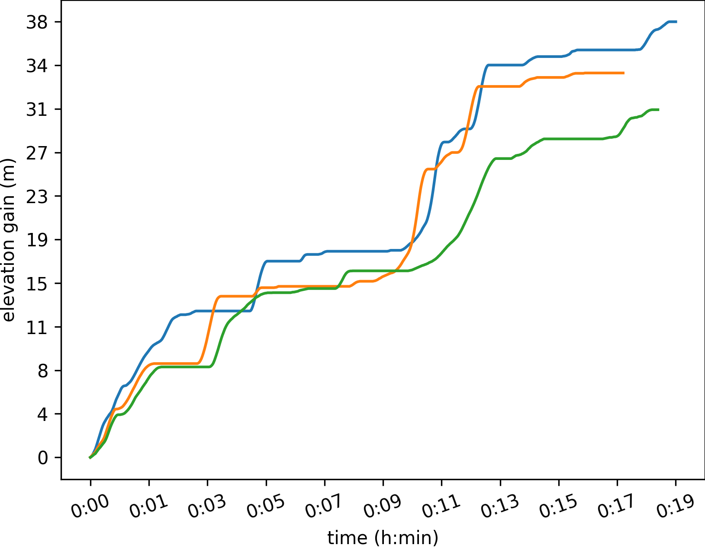
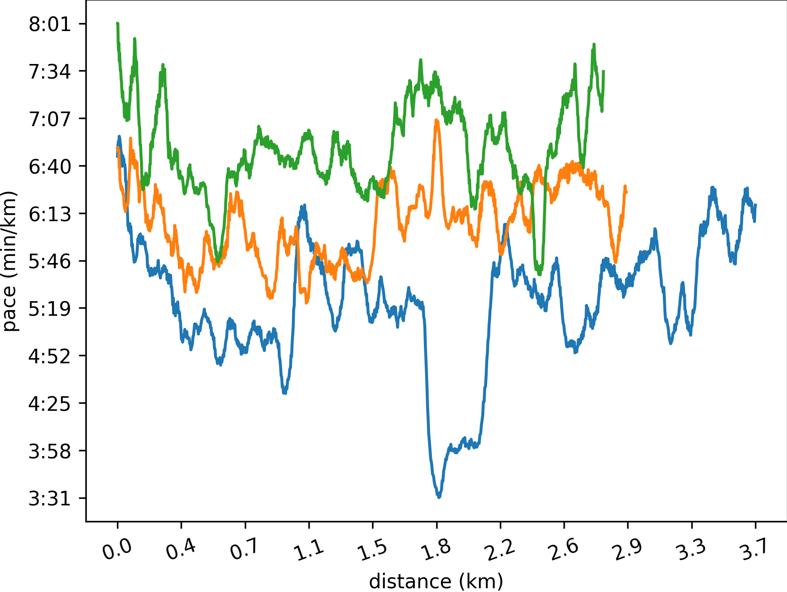
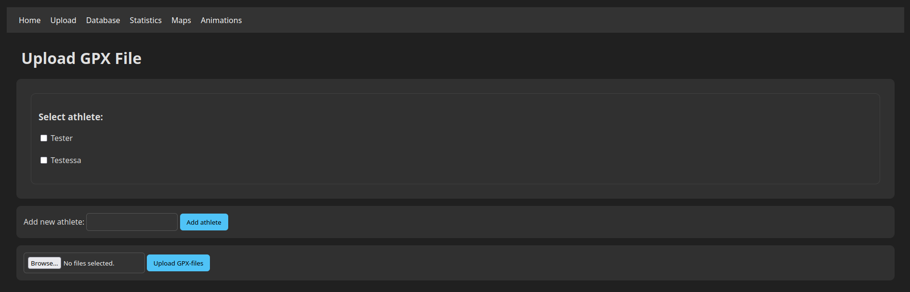
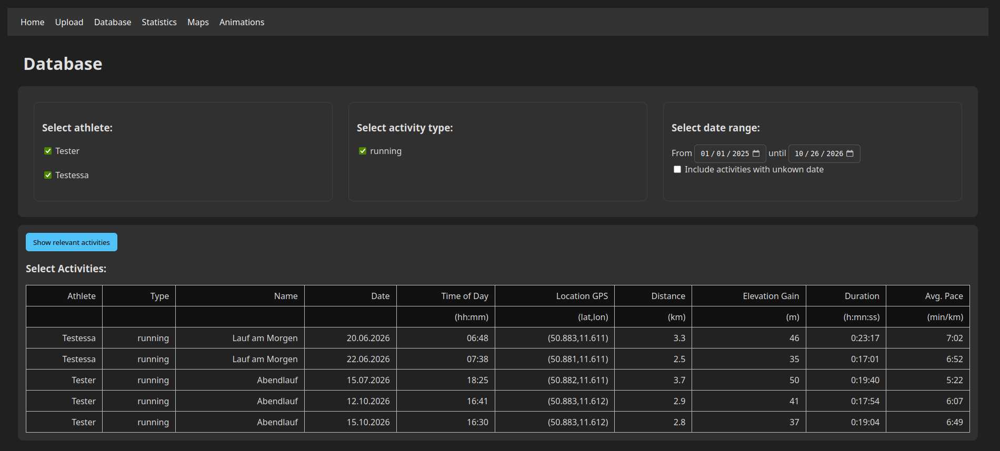
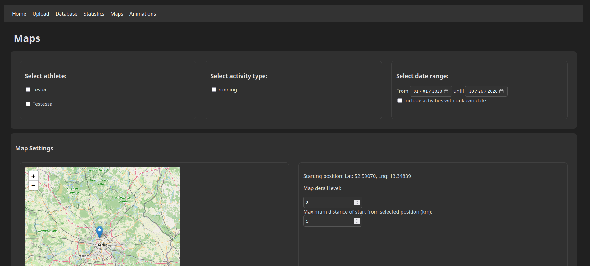

# GPX Visualiser
Successor of https://github.com/Feathergunner/Activisualizer

Visualizing data from gpx-files:
- plotting routes on maps: supports plotting multiple routes on a single map, and different colors for sets of routess
- freely configurable plots of distance, height, elevation gain, slope, and (if timestamps are contained in gpx-files) time, speed, pace

## Examples
### Animation of a Single Activity

### Map of Multiple Activities
Activities from two different athletes are displayed, one in red, the other in blue.

### Plotting Activity Data
For example: elevation profile, total elevation gain, or pace. The x- and y-axes can be specified individually.

## The User Interface
All scripts can be used via a webinterface, with a local python-flask-server as backend.
To visualize an activity, gpx-files have to be added to the database in the "Upload" tab:

In the "Database" tab, you can see all database-entries:

To create a plot, a subset of activities can be selected. This is simply done via the UI by specifying an athlete, an activity-type (e.g. 'running', 'hiking' or 'cycling'), and a date-range.
You also restrict the location of the activities, so you don't accidentally create a huge map that contains all of your hiking trips from all over the world (but if you really want to, you still can generate such a map).

## How To Start
1) Run `python App.py` to start a local flask server.
2) Open `127.0.0.1:5000` in a webbrowser.
3) Load your gpx-files (see instructions in webfrontend)
4) Create plots from your data (see instructions in webfrontend)

## Requirements
python 3.10-ish with packages:
- flask
- flask_sqlalchemy
- sqlalchemy
- gpxpy
- matplotlib
- numpy
- PIL
- shutil

and ffmpeg (to generate the animations).

## Future Features
- More options for creating animations (multiple activities at once, zoomed-in map).
- More options for managing your database of activities (renaming activities, deleting activities).
- QOL features: storing default parameters.
- Improved progress bar.
